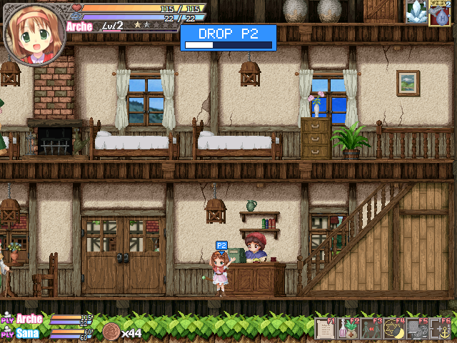
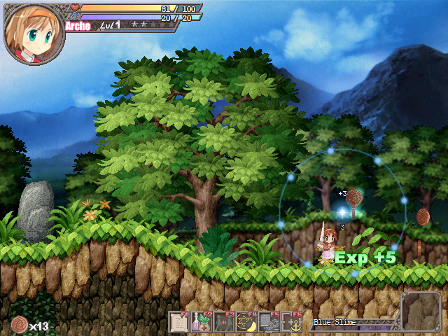
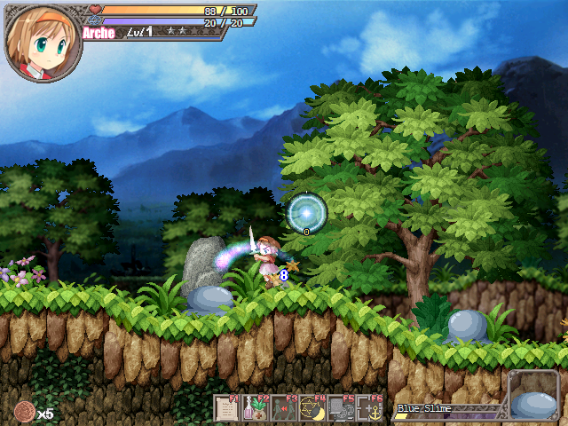
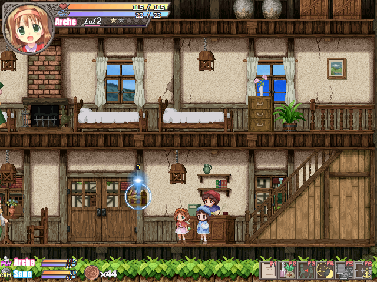
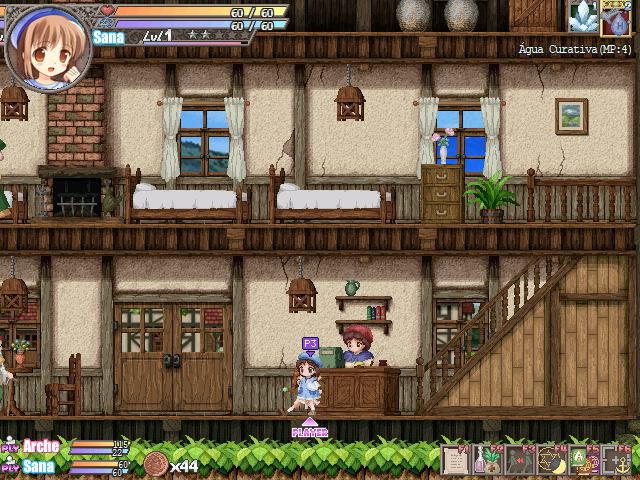

# CoopSummoners

**Play _Fortune Summoners: Secret of the Elemental Stone_ with up to 3 friends on one PC.**

In the base game you control one girl and the AI controls the rest of the party. CoopSummoners
lets your friends take over those allies: explore, fight and cast spells together on one screen,
each with a gamepad or the keyboard. A friend with no character still gets to help as a little
light that collects coins, carries items and heals the party.

| | |
|:---:|:---:|
|  |  |
| Player 2 plays Sana; player 1 leads with Arche | A friend with no character flies a light that grabs coins |

> Unofficial fan project. Not affiliated with Lizsoft or Carpe Fulgur. **No game files are
> included:** you need your own copy of the game (Steam, 2012 edition).

**[⬇ Download the latest version](https://github.com/BLKNeko/CoopSummoners/releases)** ·
[Install](#install) · [Controls](#controls) · [Problems?](#troubleshooting)

---

## What you get

- **Up to 3 players** on the same PC, each with the keyboard or their own gamepad.
- **Drop in and out at any time:** hold the switch button to join or leave. The AI plays the
  characters nobody is using.
- **Swap characters** with another player by pressing switch at the same time.
- **A support light** for players waiting for a character: collects coins, pulls them in
  with a magnet, carries items to the leader, sends a healing wave and pings spots on screen.
- **Easy launcher:** finds the game, installs the mod in one click, sets each player's
  controls and backs up your saves.
- **Smooth full screen** (no lag on Windows 10 / 11) and bigger window sizes.
- **Brazilian Portuguese translation** (optional).
- Without co-op, the game plays **exactly like the original**.

| | | |
|:---:|:---:|:---:|
|  |  |  |
| The light's wave heals nearby allies | Carrying an item to the leader | A third player (here with the Portuguese translation) |

---

## Requirements

- **Fortune Summoners: Secret of the Elemental Stone**, the **2012 Steam English edition**
  ([store page](https://store.steampowered.com/app/203510/Fortune_Summoners/)). The 2020
  *Special Edition* and the Japanese release are **not** supported.
- **Windows 10 or 11.**
- A keyboard and/or gamepads (one per player).

---

## Install

1. Download **`CoopSummoners.zip`** from the
   [**Releases**](https://github.com/BLKNeko/CoopSummoners/releases) page.
2. Extract the **whole zip** into any folder.
3. Run **`CoopSummoners.exe`**. It finds the game in your Steam library (if it doesn't, click
   **Browse...** and pick the folder with `sotes.exe`).
4. Click **Install mod**. Your saves are backed up first.
5. Plug in the gamepads, choose each player's device, and click **Play Co-op**.


**To update:** extract the new zip over the old one and click **Update mod** in the launcher.
Your saves and settings are kept.

> Windows may warn that the exe is not signed: click **More info** → **Run anyway** (only for
> files from this page's Releases).

In the launcher you can also pick the **game language**, the **screen mode** (borderless full
screen is recommended), the **window size**, and see all the **controls**.

---

## Controls

Each player picks a device in the launcher. Players 2 and 3 can change their keys or buttons
with **Keys...**.

| Action | Player 1 | Player 2 (keyboard) | Player 3 (keyboard) | Gamepad (players 2 / 3) |
|---|---|---|---|---|
| Move | arrow keys | numpad **8 / 5 / 4 / 6** | **I / K / J / L** | stick or d-pad |
| Attack | game setting (**X**) | numpad **1** | **U** | X |
| Jump | game setting (**C**) | numpad **2** | **O** | A |
| Use / talk | game setting | numpad **3** | **P** | B |
| Skill modifier | game setting | numpad **0** | **Y** | LB |
| Switch | **Enter** | numpad **+** | **H** | Y |

Player 1 uses the game's own key setup (set it in the game's options).

### The switch button

| What you do | What happens |
|---|---|
| Player 2 / 3 **holds switch 1 s** | **Joins** the game with a free ally. |
| Player 2 / 3 **holds switch 1.5 s** | **Leaves**; the AI plays the character again. |
| **Two players tap switch together** | They **swap characters**. |
| One player taps switch alone | The game's normal character switch. |
| Player 1 **holds switch 5 s** | Drops everyone else out. |

### The light (players with no character)

| What you do | What happens |
|---|---|
| Press anything | The light appears. It flies through walls. |
| Touch a coin | Picks it up for the party. |
| **Tap attack** | **Wave**: heals nearby allies (8 % HP) and hurts enemies a little. Every 20 s. |
| **Hold attack** | **Magnet**: pulls nearby coins in. |
| **Hold jump** | **Carries an item** to the leader. |
| Use | **Ping**: rings to point something out. |

The light goes away after 10 s without input. The number under it counts the coins you collected.

---

## Good to know

- **Player 1 is always the leader:** the camera follows them, and only they talk to people,
  open menus and read signs.
- During **cutscenes**, the AI plays everyone's characters for a moment, then gives them back.
- A character at **0 HP** stays with its player: they can walk and jump but not attack until
  healed. **Game over** only when the whole party is down.
- A blue **P2** / purple **P3** badge shows each player's character; an arrow on the screen
  edge shows where they are when off screen.
- **Playing online:** the mod is local co-op. To play with friends far away, stream the game
  with [Parsec](https://parsec.app/) (not tested yet).
- **Portuguese:** pick *Português (Brasil)* under *Game language* in the launcher (or
  *Português, nomes originais* to keep the English names of items, spells and places). It was
  machine translated and is being reviewed, so expect some odd lines.

### Known limits

- One camera, following player 1. Players 2 and 3 can walk off screen.
- Three players at most (the party has three members).
- Not fully tested yet: every cutscene, streaming over Parsec.

---

## Troubleshooting

| Problem | What to try |
|---|---|
| Windows SmartScreen blocks the exe | Click **More info** → **Run anyway** (only for files from this repository's Releases). |
| The launcher can't find the game | Click **Browse...** and choose the folder with `sotes.exe` (Steam: right-click the game → **Manage** → **Browse local files**). |
| "Install mod" says access is denied | Close the game and try again, or run `CoopSummoners.exe` as administrator. |
| Player 2 or 3 can't do anything | They start out of the game: hold switch for 1 s to join. At the very start of a new game Arche is alone, so they join once Sana does. Check their device in the launcher. |
| A gamepad does nothing / wrong player | Plug the pads in **before** starting the game, and pick each player's pad by name in the launcher. |
| A character stands still, nobody plays it | Player 1 holds switch for 5 s: everyone else is dropped out and the AI takes over. |
| I need an older save | `user-backups\` in the game folder keeps the last 5 versions: close the game and copy one back over `user\`. |
| The game crashed | A message names a folder `crashes\crash-<date>-<time>\` with logs and saves: attach it to an [issue](https://github.com/BLKNeko/CoopSummoners/issues). |

## Uninstall

Click **Uninstall** in the launcher, then delete the launcher's folder. Your saves and backups
stay in the game folder; the original game files are never changed.

---

# Technical details

Everything below is for advanced users and developers.

- [Manual install (without the launcher)](#manual-install-without-the-launcher)
- [Building from source](#building-from-source)
- [How it works](#how-it-works)
- [How the translation works](#how-the-translation-works)
- [Tests](#tests)

### Tested version

Tested with Steam build 29910, `sotes.exe` SHA-256
`7D779F2EB02B3C603857FEDBC52BE6973AC3B0B2C5C1BC696122DDAC89FB9F1B`. To check your copy, run
this in PowerShell inside the game folder:

```powershell
Get-FileHash .\sotes.exe -Algorithm SHA256
```

### More on the launcher and the game

- Screen modes: *Borderless full screen* (default; a borderless window over the whole monitor,
  the picture scaled to the screen's height), *Window* (*Original*, *Largest that fits* or 2× /
  3×), *Original full screen* (the base game's, slow on Windows 8 and later since it emulates a
  16-bit display mode) or *Ask each time* (the game's own options window). Command line:
  `--screen 3 --borderless`, `--window-scale 2|3|auto`.
- The launcher remembers its settings in `%APPDATA%\CoopSummoners\launcher.ini` and the players'
  controls in `coop-controls.ini`; it shows English or Portuguese following Windows (`--lang en`
  / `--lang pt` to override).
- Save backups: the first install copies `user\` to `user-backup-<date>`; every game started from
  the launcher copies it to `user-backups\<date>-<time>\` (when it changed), keeping the last 5.
- The spell panel (top right) shows player 2's (else 3's) spells when player 1's character
  doesn't cast.
- A gamepad unplugged and plugged back in works again within a moment (`coop.log` logs it).
- Uninstalling removes only the mod's files. `temp\` and `fs_boot.log` belong to the game itself.

---

## Manual install (without the launcher)

If you prefer not to use the launcher, or want the mod in a separate folder instead of the
Steam one:

### Step 1: get `opensummoners-standalone.exe`

- **Download** it from this repository's
  [**Releases**](https://github.com/BLKNeko/CoopSummoners/releases) page, **or**
- **build it** yourself (see [Building from source](#building-from-source)).

> Do not use the `opensummoners-standalone.exe` from the upstream OpenSummoners project:
> it has no co-op.

### Step 2: make a play folder

You can put the exe straight into the Steam game folder, but a separate copy keeps your
Steam install untouched.

1. Open the game folder. In Steam: right-click **Fortune Summoners** → **Manage** →
   **Browse local files**. The default location is
   `C:\Program Files (x86)\Steam\steamapps\common\Fortune Summoners`.
2. Create a new folder, for example `C:\Games\FortuneSummonersCoop`.
3. Copy these 5 files from the game folder into the new folder:

   ```
   sotes.exe
   sotesd.dll
   sotesw.dll
   sotesp.dll
   lizsoft.spl
   ```

4. **(Optional) keep your progress:** also copy the game folder's `user` folder (your
   saves and settings) into the new folder.

### Step 3: add the mod

Copy `opensummoners-standalone.exe` into the same folder. It should now contain:

```
FortuneSummonersCoop\
├── opensummoners-standalone.exe   ← the mod
├── sotes.exe
├── sotesd.dll
├── sotesw.dll
├── sotesp.dll
├── lizsoft.spl
└── user\                          ← (optional) your saves
```

### Step 4: create the shortcuts

Co-op is turned on with the `--coop` option. The easiest way is two small `.bat` files in
the same folder.

1. In the folder, right-click → **New** → **Text Document**. Name it `Play Coop.bat`
   (turn on *View → File name extensions* in Explorer so the name doesn't end in `.txt`).
2. Open it in Notepad, paste the following and save:

   ```bat
   @echo off
   cd /d "%~dp0"
   start "" opensummoners-standalone.exe --coop
   ```

3. (Optional) make `Play Solo.bat` the same way, for the normal single-player game:

   ```bat
   @echo off
   cd /d "%~dp0"
   start "" opensummoners-standalone.exe
   ```

**Alternatives to the `.bat` file:**

- **Desktop shortcut:** right-click the exe → **Create shortcut** → shortcut **Properties**.
  Under **Target**, add ` --coop` after the closing quote, for example:
  `"C:\Games\FortuneSummonersCoop\opensummoners-standalone.exe" --coop`.
- **Steam:** **Games** → **Add a Non-Steam Game to My Library** → pick
  `opensummoners-standalone.exe` → in its **Properties**, set **Launch Options** to `--coop`.
- **Environment variable:** `OPENSUMMONERS_COOP=1` has the same effect as `--coop`.

### Step 5: play

1. Plug in the gamepads **before** starting the game. The first pad Windows lists is
   player 1's and the second is player 2's.
2. Double-click `Play Coop.bat`.
3. The game's usual launcher window appears: choose the screen mode and click Launch.
4. Start a new game or load a save. Player 2 joins automatically as soon as an ally is in
   the party. At the very start of a new game Arche is alone, so player 2 joins when Sana
   joins the party.

Saves and settings are written to the play folder's `user\` folder. A log and an audit
file go to `opensummoners-standalone\`, and gamepad messages go to `coop.log`.
---

## Building from source

Everything builds on Linux or **WSL2 on Windows**, inside a Nix shell with the mingw-w64
cross compiler. No game files are needed to build.

### On Windows (WSL2)

1. **Install WSL2 + Ubuntu** in PowerShell as administrator, then reboot:

   ```powershell
   wsl --install -d Ubuntu
   ```

2. **Install Nix** (single-user) in the Ubuntu terminal, and turn on flakes:

   ```bash
   sh <(curl -L https://nixos.org/nix/install) --no-daemon
   mkdir -p ~/.config/nix
   echo "experimental-features = nix-command flakes" >> ~/.config/nix/nix.conf
   ```

   Close and reopen the terminal (or run `. ~/.nix-profile/etc/profile.d/nix.sh`).

3. **Clone inside the Linux file system** (not under `/mnt/c`: it is much slower there, and
   Windows line endings break the build):

   ```bash
   git clone https://github.com/BLKNeko/CoopSummoners.git ~/CoopSummoners
   cd ~/CoopSummoners
   ```

4. **Build:**

   ```bash
   nix develop .#ci --command bash tools/rhost/build.sh
   ```

   The first run downloads the toolchain and takes a few minutes. The result is
   `build/rhost/opensummoners-standalone.exe` (the game, with co-op) and
   `build/rhost/rhost.exe` (the test host).

5. **Copy the exe to Windows**, for example:

   ```bash
   cp build/rhost/opensummoners-standalone.exe /mnt/c/Games/FortuneSummonersCoop/
   ```

6. **The launcher and the release zip:**

   ```bash
   nix develop .#ci --command bash tools/launcher/build.sh --package
   ```

   This gives `build/launcher/CoopSummoners.exe` and `build/launcher/CoopSummoners.zip`
   (the launcher, the mod exe and a short README.txt in English and Portuguese, with no game
   files). Upload the zip to a GitHub release. The launcher accepts `--lang en` / `--lang pt`
   to override the Windows language.

The full pre-push check (the port, the tools and the host test suite) is
`nix develop --command bash tools/ci/build_all.sh`.

### Reviewing the translation

The tools in `tools/translation/` (Python 3, no extra packages) work from your own copy of
the game. Their working files go to `build/translation/`, which is not committed, because they
contain the game's English text.

```bash
python tools/translation/extract_text.py "C:\path\to\Fortune Summoners"
python tools/translation/tables.py "C:\path\to\Fortune Summoners"
python tools/translation/review.py export
```

`build/translation/review-pt-br.csv` opens in Excel or LibreOffice with the English and the
Portuguese side by side (plus STATUS / NOTE columns for you). Edit the PT column, save as CSV,
then:

```bash
python tools/translation/review.py import
```

Each edit is checked (the game's codes such as `%n`, `%s`, `@@X` kept, the byte limit of
strings copied into fixed buffers or written into a table field, characters the game can draw)
and written into `data/lang/pt-br.tsv` / `pt-br.names.tsv`; the "original names" file
(`en_names.py`) is rebuilt from them. `tables.py` lists the table strings and their room,
`make_batches.py` and `merge.py` are the tools that produced the machine translation.

---

## How it works

CoopSummoners is built on **[OpenSummoners](https://github.com/Francesco149/OpenSummoners)**,
an open-source C reimplementation of `sotes.exe` by its own author. OpenSummoners runs the
game entirely on its own code, using only the *data* from your game files. Because the whole
engine is readable C, co-op can be added to the game's own logic instead of being patched
into the original, DRM-protected 32-bit binary.

The engine already had the pieces co-op needs:

- Each room keeps an array of **input managers** (`wl_room.nin` / `.in`); the base game
  creates only one.
- Each party slot holds the **manager that drives it** (`wl_pslot.in`), and the game's
  `pslot_input_set` (0x4cc5a0) switches a member between player control (`char_ai`) and
  the party AI (`char_behave`).
- The leader switch (`room_leader_next`) only picks members with no manager, so a member
  held by player 2 is never taken.

With co-op on, the room gets **three input managers** (player 1 = the game's own; players 2 and 3 = co-op's
producers, from each player's keyboard keys or own gamepad as `coop-controls.ini` sets them), and
`coop_tick` attaches each joined player to a free party member while player 1 is in control.

| File | What it does |
|---|---|
| `src/coop.c`, `src/coop.h` | Everything co-op: players 2 / 3's input (keys, gamepads), attach / release, the switch rules, the fallen-character filter, the spell panel choice, the lights (coins, magnet, carrying items, the wave, ping), the P2 / P3 markers and notices. |
| `src/scene_loop.c` | Creates the extra input managers when co-op is on. |
| `src/room_loop.c` | Feeds players 2 / 3 (`coop_produce`); runs `coop_tick`; filters a fallen player's commands. |
| `src/input_dev.c` | Gamepad re-acquire after hot-plug (co-op only); player 1's gamepad from the launcher's choice. |
| `src/render_draw.c` | The spell panel can show player 2's caster. |
| `src/char_state.c` | NULL guard in `char_add_hp` (a fallen player 2 falling into a pit crashed). |
| `tools/rhost/` | The `--coop` option, the P2 marker overlay drawn before each Flip, and test-only options. |
| `tools/launcher/` | `CoopSummoners.exe`: finds the game in Steam (registry + `libraryfolders.vdf`), checks `sotes.exe` by SHA-256, installs / updates / removes the mod exe in the game folder, backs up `user\`, lists gamepads in the game's DirectInput 7 order, and starts the game with or without `--coop`. Not part of the port. |

Every change is behind `g_coop`: **without `--coop` the game is identical to upstream
OpenSummoners** (frame, tick, random-number state and every frame's pixels on the recorded
scenarios).

To learn how the port itself works (the engine, rhost, verification against the original),
see the [OpenSummoners README](https://github.com/Francesco149/OpenSummoners#readme) and
[`docs/`](docs/) (`docs/standalone.md`, `docs/STATUS.md`, `docs/findings/`).

---

## How the translation works

Machine translated with a fixed glossary
([`tools/translation/glossary-pt-br.md`](tools/translation/glossary-pt-br.md)); to review it see
[Reviewing the translation](#reviewing-the-translation). The game can also be started with
`--lang pt-br` (plus `--lang-names original` for the original names); `lang.log` in the game
folder says what loaded. The files, in `data/lang/` (installed into the game folder's `lang\`):

| File | What |
|---|---|
| `pt-br.tsv` | everything but the table names |
| `pt-br.names.tsv` | the names of items, spells, moves, monsters and places |
| `pt-br.en-names.tsv` | for "original names": the sentences that mention one of those names, with the name in English |

How it works: the 2012 edition keeps its text inside `sotes.exe`. With a translation loaded,
`src/lang.c` hands the port the translated copy of each string it reads through `g_eng.data`;
strings the game reads out of tables (an item row, a book page) are written over the game's own
text in memory before it starts, each within the room its field has (`@N` in the files). The
text layer treats bytes above 127 as single Windows-1252 letters instead of Japanese
double-byte characters (`text_lead` in `src/lang.h`). Without `--lang`, nothing changes.

---

## Tests

The tests use OpenSummoners' **rhost**, which replays recorded keyboard input with a virtual
clock, so a run is the same every time.

- **Co-op off = upstream:** `tools/coop/gate.ps1` runs the recorded scenarios
  (`tests/scenarios/rh-*`) through `rhost.exe --standalone` on a Windows PC. With co-op off,
  frame, tick, random-number state and framebuffer hash match upstream OpenSummoners on all
  10 fresh-start scenarios.
- **Co-op behaviour:** traces in `tools/coop/tests/` (T1–T5: swap, lone taps, drop-out and
  rejoin, late tap; T6–T9: drop-out hold, join button, player 3; F1: falls, the fallen-player
  filter, the pit crash; L1–L4: the light's coins and magnet, player 3's light, carrying, the
  wave). Their expected
  results are in [`tools/coop/tests/README.md`](tools/coop/tests/README.md).
- **Test-only options:** `--coop-test-hp FRAME:WHO:HP` sets a character's HP and
  `--coop-test-drop FRAME:WHO` drops one below the map (WHO: 0 = leader, 1 = player 2).
- `tools/coop/trace_p2.py` strips the numpad from a recorded trace and overlays player 2's
  key holds.

Example (from PowerShell, with the repository in WSL):

```powershell
.\tools\coop\gate.ps1 -Repo \\wsl.localhost\Ubuntu\home\<you>\CoopSummoners `
    -Game C:\fs-base -Out C:\fs-gate -Coop
```

Some things can only be tested by hand: real gamepads (rhost has no joysticks) and long
play sessions.

---

## Credits

- **CoopSummoners** (the co-op mod): BLKNeko.
- **[OpenSummoners](https://github.com/Francesco149/OpenSummoners)** by Francesco149 and
  contributors: the C reimplementation of the engine this mod is built on (MIT). Without
  it this mod would not exist.
- **Fortune Summoners** by **Lizsoft**, English localization by **Carpe Fulgur**. Please
  support them: buy the game on
  [Steam](https://store.steampowered.com/app/203510/Fortune_Summoners/) (2012 edition, the
  one this mod needs) or the
  [Special Edition](https://store.steampowered.com/app/1381770/Fortune_Summoners_Special_Edition/).
- The **Fortune Summoners Fan Discord** ([invite](https://discord.gg/N68c7pt)) for its
  community reverse-engineering work, which OpenSummoners cross-checked against.

---

## License

MIT, see [`LICENSE`](LICENSE). It covers OpenSummoners' code and the CoopSummoners co-op
changes only. **No rights are granted to the original game or its assets**, and none are
included in this repository or its releases.
