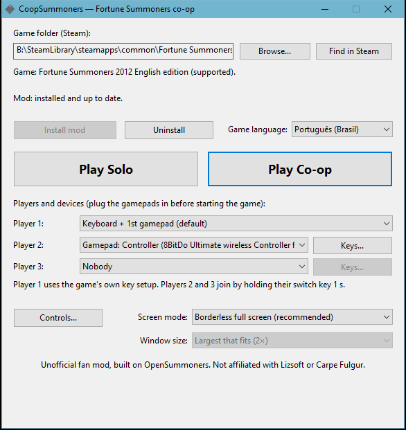

# CoopSummoners

**Local co-op for _Fortune Summoners: Secret of the Elemental Stone_.**
Up to two more players take control of the party members that the AI would otherwise drive,
on the same PC, each with a gamepad or the keyboard.

In the base game you control one character and the AI controls the others. CoopSummoners
lets a friend take over one of those allies: you explore, fight and cast spells together on
one screen.

> Unofficial fan project. Not affiliated with Lizsoft or Carpe Fulgur. **No game files are
> included:** you need your own copy of the game.

---

## Contents

- [Features](#features)
- [Requirements](#requirements)
- [Install the co-op mod](#install-the-co-op-mod)
- [Controls](#controls)
- [How co-op works in game](#how-co-op-works-in-game)
- [Playing online with friends](#playing-online-with-friends)
- [Known limits](#known-limits)
- [Troubleshooting](#troubleshooting)
- [Uninstall](#uninstall)
- [Building from source](#building-from-source)
- [How it works (technical)](#how-it-works-technical)
- [Tests](#tests)
- [Credits](#credits)
- [License](#license)

---

## Features

- **A launcher** (`CoopSummoners.exe`) that finds the game in Steam, installs the mod in one
  click, backs up your saves, lets each player pick a device (and players 2 / 3 their keys or
  buttons), and starts the game solo or in co-op. English and Portuguese.
- **Players 2 and 3 control party allies** (Sana, Stella...) instead of the AI, each with the
  keyboard or a gamepad.
- **Join by holding switch**: with the launcher's *Play Co-op*, players 2 and 3 start out of
  the game (the AI plays the allies) and join by holding their *switch* key / button for 1 s,
  taking a free party member. With one free ally and two players wanting it, whoever joins
  first plays it; the other **waits** and takes the next member that is free.
- **Swap characters LEGO-style**: any two players press *switch* within half a second and
  trade characters.
- **Drop out / drop in**: player 2 or 3 holds *switch* for 1.5 s to leave (the AI takes the
  character back) and 1 s to rejoin. Player 1 can drop everyone else out by holding *switch*
  for 5 s.
- **On-screen notices**: "P2 / P3 joined / left / waiting" and bars while a switch hold fills.
- **A light for players with no character**: player 2 or 3 out of the game (or waiting for a
  free ally) flies a small light (blue / purple) that picks up coins, pulls them in with a
  magnet, carries items to the leader, lets out a healing / damaging wave every 20 s and pings
  spots for the others. It counts that player's coins.
- **Crash report**: if the game closes on an error, a message says so and the logs plus a
  copy of the saves go to `crashes\crash-<date>-<time>\` in the game folder.
- **Save backups**: every time the launcher starts the game, it copies `user\` to
  `user-backups\<date>-<time>\` (when it changed) and keeps the last 5.
- **Fallen characters stay with their player**: a player at 0 HP can still walk, jump and
  investigate, but cannot attack or cast until healed. Game over only when the whole party
  is down, as in the base game.
- **"P2" (blue) / "P3" (purple) markers** above players 2 and 3's characters, and an arrow on
  the screen edge when one is off screen.
- **Spell panel for players 2 / 3**: when player 1's character doesn't cast but player 2 (else
  3) drives a caster, their spells show in the top-right panel.
- **Gamepad hot-plug**: a pad that is unplugged and plugged back in works again within a
  moment.
- **Brazilian Portuguese translation** (machine translated, being reviewed): pick
  "Português (Brasil)" in the launcher (or "Português, nomes originais" to keep the item, spell,
  monster and place names in English), or start the game with `--lang pt-br`. See
  [Portuguese translation](#portuguese-translation).
- **Full screen without the lag**: the base game's full screen is slow on Windows 8 and later
  (it emulates a 16-bit display mode). *Borderless full screen* (the launcher's default
  *Screen mode*; command line `--no-launcher --screen 3 --borderless`) is a borderless window
  over the whole monitor, the picture scaled to the screen's height with black bars at the
  sides.
- **Bigger window**: in *Window* mode the window can be 2× or 3× the original 640×480, or
  the largest size that fits the screen (launcher: *Window size*; command line:
  `--window-scale 2|3|auto`). A size too big for the screen falls back to the largest that fits.
- **Off by default**: without `--coop` the game runs exactly like the base game.

---

## Requirements

| | |
|---|---|
| Game | **Fortune Summoners: Secret of the Elemental Stone**, Steam 2012 English edition ([store page](https://store.steampowered.com/app/203510/Fortune_Summoners/), app 203510). The stock Steam files work as they are. |
| Not supported | The 2020 **Special Edition** (app 1381770) and the Japanese release. |
| OS | Windows 10 or 11. |
| Controllers | Each player: the keyboard or a gamepad (chosen in the launcher). Player 1 can also use both. |

Tested with Steam build 29910, `sotes.exe` SHA-256
`7D779F2EB02B3C603857FEDBC52BE6973AC3B0B2C5C1BC696122DDAC89FB9F1B`.

To check your copy, run this in PowerShell inside the game folder:

```powershell
Get-FileHash .\sotes.exe -Algorithm SHA256
```

---

## Install the co-op mod

The mod is a single program, `opensummoners-standalone.exe`, that runs the game in place of
`sotes.exe`. It reads the data from your own game files and **never changes them**.

### Easiest: the CoopSummoners launcher

1. Download **`CoopSummoners.zip`** from the
   [**Releases**](https://github.com/BLKNeko/CoopSummoners/releases) page.
2. Extract the **whole zip** into any folder (keep `CoopSummoners.exe` and
   `opensummoners-standalone.exe` together).
3. Run **`CoopSummoners.exe`**. It finds Fortune Summoners in your Steam libraries and
   checks it is the supported version. If it can't find it, click **Browse...** and choose
   the game folder (the one with `sotes.exe`).
4. Click **Install mod**. The launcher copies the mod into the game folder and, the first
   time, backs up your saves (`user\` → `user-backup-<date>`).
5. Plug in the gamepads and click **Play Co-op** (or **Play Solo**). The game starts in the
   launcher's *Screen mode* (default: borderless full screen). Pick *Ask each time* there to
   get the game's own options window instead.



The launcher also:

- sets each **player's device** (keyboard or a gamepad, by name) and players 2 / 3's **keys or
  buttons** (**Keys...**);
- shows the full **controls** (button **Controls...**);
- **backs up the saves** before every game (`user-backups\`, the last 5 versions);
- sets the **screen mode**: *Borderless full screen* (recommended, the default), *Window*,
  *Original full screen* (the base game's, may lag) or *Ask each time* (the game's own options
  window);
- sets the **window size** for *Window* (*Original*, *Largest that fits* — the default — or
  2× / 3×; a size that doesn't fit the screen says so), with the picture scaled pixel for pixel;
- **updates** the mod when you extract a newer zip over the old one (button **Update mod**);
- **uninstalls** it (button **Uninstall**): it removes only the mod's files, and your saves
  and backups stay;
- shows its text in **English or Portuguese**, depending on the Windows language.

It remembers the game folder in `%APPDATA%\CoopSummoners\launcher.ini`.

### Manual install

If you prefer not to use the launcher, or want the mod in a separate folder instead of the
Steam one:

#### Step 1: get `opensummoners-standalone.exe`

- **Download** it from this repository's
  [**Releases**](https://github.com/BLKNeko/CoopSummoners/releases) page, **or**
- **build it** yourself (see [Building from source](#building-from-source)).

> Do not use the `opensummoners-standalone.exe` from the upstream OpenSummoners project:
> it has no co-op.

#### Step 2: make a play folder

You can put the exe straight into the Steam game folder, but a separate copy keeps your
Steam install untouched.

1. Open the game folder. In Steam: right-click **Fortune Summoners** → **Manage** →
   **Browse local files**. The default location is
   `C:\Program Files (x86)\Steam\steamapps\common\Fortune Summoners`.
2. Create a new folder, for example `C:\Games\FortuneSummonersCoop`.
3. Copy these 5 files from the game folder into the new folder:

   ```
   sotes.exe
   sotesd.dll
   sotesw.dll
   sotesp.dll
   lizsoft.spl
   ```

4. **(Optional) keep your progress:** also copy the game folder's `user` folder (your
   saves and settings) into the new folder.

#### Step 3: add the mod

Copy `opensummoners-standalone.exe` into the same folder. It should now contain:

```
FortuneSummonersCoop\
├── opensummoners-standalone.exe   ← the mod
├── sotes.exe
├── sotesd.dll
├── sotesw.dll
├── sotesp.dll
├── lizsoft.spl
└── user\                          ← (optional) your saves
```

#### Step 4: create the shortcuts

Co-op is turned on with the `--coop` option. The easiest way is two small `.bat` files in
the same folder.

1. In the folder, right-click → **New** → **Text Document**. Name it `Play Coop.bat`
   (turn on *View → File name extensions* in Explorer so the name doesn't end in `.txt`).
2. Open it in Notepad, paste the following and save:

   ```bat
   @echo off
   cd /d "%~dp0"
   start "" opensummoners-standalone.exe --coop
   ```

3. (Optional) make `Play Solo.bat` the same way, for the normal single-player game:

   ```bat
   @echo off
   cd /d "%~dp0"
   start "" opensummoners-standalone.exe
   ```

**Alternatives to the `.bat` file:**

- **Desktop shortcut:** right-click the exe → **Create shortcut** → shortcut **Properties**.
  Under **Target**, add ` --coop` after the closing quote, for example:
  `"C:\Games\FortuneSummonersCoop\opensummoners-standalone.exe" --coop`.
- **Steam:** **Games** → **Add a Non-Steam Game to My Library** → pick
  `opensummoners-standalone.exe` → in its **Properties**, set **Launch Options** to `--coop`.
- **Environment variable:** `OPENSUMMONERS_COOP=1` has the same effect as `--coop`.

#### Step 5: play

1. Plug in the gamepads **before** starting the game. The first pad Windows lists is
   player 1's and the second is player 2's.
2. Double-click `Play Coop.bat`.
3. The game's usual launcher window appears: choose the screen mode and click Launch.
4. Start a new game or load a save. Player 2 joins automatically as soon as an ally is in
   the party. At the very start of a new game Arche is alone, so player 2 joins when Sana
   joins the party.

Saves and settings are written to the play folder's `user\` folder. A log and an audit
file go to `opensummoners-standalone\`, and gamepad messages go to `coop.log`.

---

## Controls

Each player's **device** is picked in the launcher (*Player 1 / 2 / 3*): player 1 *Keyboard +
1st gamepad* (the default), *Keyboard only* or a gamepad; players 2 and 3 *Nobody*, *Keyboard* or
a gamepad (listed by name, remembered even while unplugged). Two players on one gamepad get a
warning.

| Action | Player 1 | Player 2 (default keyboard keys) | Player 3 (default keyboard keys) |
|---|---|---|---|
| Move | arrow keys | numpad **8 / 5 / 4 / 6** | **I / K / J / L** |
| Attack | game config (default **X**) | numpad **1** | **U** |
| Jump | game config (default **C**) | numpad **2** | **O** |
| Use / investigate | game config | numpad **3** | **P** |
| Sheathe / skill modifier | game config | numpad **0** | **Y** |
| Switch character | **Enter** / game config | numpad **+** | **H** |

- **Player 1** uses the game's own key configuration (set it in the game's options), on the
  keyboard and on player 1's gamepad.
- **Players 2 and 3** set their own keys (keyboard) or buttons (gamepad) with **Keys...** next
  to their device: click an action, press the key / button (Esc cancels). Gamepads move with
  the left stick or the d-pad; default buttons: attack 3, jump 1, use 2, sheathe 5, switch 4
  (X, A, B, LB, Y on an Xbox-style pad).
- The numpad keys work whether Num Lock is on or off.
- To cast or use a skill, players 2 / 3 hold their sheathe / skill modifier with a direction,
  just as player 1 does with theirs.

---

## How co-op works in game

### Who controls what

- **Player 1 is always the leader**: the camera follows player 1's character, and player 1
  talks to people, opens menus and reads signs.
- **Players 2 and 3** each control a party member that is free (not the leader, not another
  player's, and not knocked down). With no free member, a player who joins **waits** and takes
  the next one that frees up (for example when the other player leaves).
- **During cutscenes and dialogue**, players 2 and 3's characters go back to the AI for the
  length of the scene, then return to the same players.

### The switch key

| What you do | What happens |
|---|---|
| **Two players tap switch within 0.5 s** | Those two **swap characters** (any pair: 1 and 2, 1 and 3, 2 and 3), even if one of them is down. Player 1 still leads. |
| **One player taps switch alone** | After the 0.5 s window, the base game's normal switch to a free AI member (nothing happens if there is none). |
| **Player 2 / 3 out of the game holds switch for 1 s** | **Joins** with a free party member (the one it had last, if free), or waits for one. With *Play Co-op* players 2 and 3 start out, so this is also how they enter the game. A bar fills while the key is held. |
| **Player 2 / 3 holds switch for 1.5 s** | **Leaves**: the AI takes the character back. |
| **Player 1 holds switch for 5 s** | **Everyone else is dropped out**, as if they had left. For when a player can't do it. |

### The light (players with no character)

Player 2 or 3 out of the game, or in and waiting for a free ally, has a light instead:

| What you do | What happens |
|---|---|
| **Any direction, attack, jump or use** | The light appears at the leader. It flies with the directions, **through walls**, and stays on screen. |
| **Touch a coin** | The coin goes to the party's money, as if a character had picked it up (the same sound; the purse cap still applies). Items are not taken: carry them to the leader (hold jump). |
| **Tap attack** | **Wave** (every 20 s): allies within ~50 px get back **8 % of their max HP** (at least 5; fallen allies are not raised), and foes within reach take **25 % of what a plain hit of the leader would deal them** (at least 1), through the game's own hit: damage number, a small hop, death, EXP and drops as usual. An arc round the light fills while it recharges (red when tapped too soon); a flash when it is ready. A character is reached by one wave per 3 s (two lights don't stack). |
| **Hold attack** | **Magnet**: a ring shows its reach, and the coins on the ground inside it fly to the light. |
| **Hold jump** | **Carry an item**: the first item on the ground the light reaches hangs under it while jump is held. Bring it to the leader, who picks it up as usual; let go and it falls. Walls and floors stop it (stuck behind, it is dropped there). |
| **Tap jump with no item near, or use** | **Ping**: rings spread where the light is, to point something out to the others. |
| **No input for 10 s** | The light goes away (any key brings it back). It also goes when you take a character, and during cutscenes and menus. |

The number under the light is that player's coins this session ("+N" rises over it as it
collects). It is not saved.

### Falling in battle

- A character at 0 HP is **"Disabled"**, as in the base game: healed by items or by
  returning to town.
- **A fallen character stays with its player.** Player 1 never takes player 2's character.
  If a free AI member exists, the base game's rule still moves player 1 to it.
- A player's fallen character **can walk, jump and investigate, but cannot attack or cast.**
- **Game over** only when the whole party is down, as in the base game.

### On screen

- A blue **P2** / purple **P3** badge points at that player's character. When the character is
  off the left or right of the screen, an arrow on that edge shows where they are.
- Panels at the top centre say when a player **joins**, **leaves** or **waits**, and show a bar
  while a switch hold fills (joining, leaving, player 1's drop-out).
- The **spell panel** (top right) shows up whenever a player controls a caster. If player 1's
  leader does not cast, it shows player 2's (else 3's) spells; player 1's portrait stays where
  it is.

---

## Playing online with friends

CoopSummoners is **local** co-op: everyone plays on the PC that runs the game. To play
with friends far away, stream the game from the host PC:

- **[Parsec](https://parsec.app/)**: the host runs the game, friends connect and their
  gamepads show up as extra pads on the host. It is free for this use.
- **Steam Remote Play Together** usually works only with games bought on Steam. The mod is
  a separate program (even when added as a non-Steam game), so it will probably not work.

Neither option has been tested with the mod yet. Real networked co-op (each player on
their own PC) is planned as later work.

---

## Portuguese translation

A Brazilian Portuguese translation ships with the mod (Portuguese text only): the dialogue, menus,
messages, item / spell / monster / place names and descriptions, speaker names, the message log and
the in-game books. It was machine translated with a fixed glossary
([`tools/translation/glossary-pt-br.md`](tools/translation/glossary-pt-br.md)) and is being
reviewed by hand over time, so expect some odd lines.

- **Use it:** under *Game language* in the launcher choose
  - **Português (Brasil)**: everything in Portuguese ("Água Curativa", "Cidade de Tonkiness");
  - **Português, nomes originais**: Portuguese text, but the names of items, spells, moves,
    monsters and places stay as the English game has them ("Heal Water", "Town of Tonkiness"),
    in the menus and inside the sentences.

  Or start the game with `--lang pt-br` (add `--lang-names original` for the second one). Accented
  letters need Windows' Western code page (any Portuguese or English Windows); `lang.log` in the
  game folder says what loaded.
- **Review it:** see [Reviewing the translation](#reviewing-the-translation) under *Building
  from source*.

The files, in `data/lang/` (installed into the game folder's `lang\`):

| File | What |
|---|---|
| `pt-br.tsv` | everything but the table names |
| `pt-br.names.tsv` | the names of items, spells, moves, monsters and places |
| `pt-br.en-names.tsv` | for "original names": the sentences that mention one of those names, with the name in English |

How it works: the 2012 edition keeps its text inside `sotes.exe`. With a translation loaded,
`src/lang.c` hands the port the translated copy of each string it reads through `g_eng.data`;
strings the game reads out of tables (an item row, a book page) are written over the game's own
text in memory before it starts, each within the room its field has (`@N` in the files). The
text layer treats bytes above 127 as single Windows-1252 letters instead of Japanese
double-byte characters (`text_lead` in `src/lang.h`). Without `--lang`, nothing changes.

---

## Known limits

- **One camera**, on player 1. Players 2 and 3 can walk off screen (the edge arrows help).
- **Players 2 and 3 cannot** open menus, talk to people or read signs: player 1 does those.
- **Three players** at most (the party has up to three members).
- **One spell panel.** If several players control casters, it shows player 1's (else 2's).
- **Not tested yet:** saving and loading with co-op on, every cutscene, streaming over
  Parsec.
- Only the **2012 English edition** is supported.

Found a bug? Open an issue with what happened. After a crash, attach the folder the error
message names (`crashes\crash-<date>-<time>\`: logs + saves); otherwise the save if you can
and the `coop.log` / `opensummoners-standalone\` files from your play folder.

---

## Troubleshooting

| Problem | What to try |
|---|---|
| Windows SmartScreen blocks the exe | The exes (`CoopSummoners.exe`, `opensummoners-standalone.exe`) aren't signed. Click **More info** → **Run anyway**, but only for files you downloaded from this repository's Releases or built yourself. |
| The launcher can't find the game | Click **Browse...** and choose the folder that has `sotes.exe` (in Steam: right-click the game → **Manage** → **Browse local files** shows it). |
| "Install mod" says access is denied | Close the game if it's running and try again. If the game is under `C:\Program Files`, right-click `CoopSummoners.exe` → **Run as administrator**. |
| A player has the wrong gamepad | Pick the right one in that player's list in the launcher (gamepads are listed by name). |
| Player 2 or 3 can't do anything | Is there a free party member? In a new game Arche starts alone. Players 2 and 3 start out of the game: hold the switch key (player 2: numpad **+**, player 3: **H**, or the switch button of their gamepad) for 1 s to join. Check their device in the launcher. |
| Player 2's character stands still (no one plays it) | Player 1 holds **switch** for 5 s: player 2 is dropped out and the AI drives the character again. |
| I need an older save | `user-backups\` in the game folder has the last 5 versions of `user\`: close the game, copy the one you want back over `user\`. |
| A gamepad does nothing | Plug both pads in **before** starting the game. A pad unplugged mid-game reconnects within a moment; check `coop.log` if it doesn't. |
| Player 1's default gamepad is the wrong one | *Keyboard + 1st gamepad* takes the first one Windows lists: pick player 1's gamepad by name instead. |
| The game starts without co-op | Check that `--coop` is in the `.bat` / shortcut / Steam launch options. |
| The game won't start at all | Check the 5 game files are in the folder next to the exe, and that `sotes.exe` is the 2012 English Steam edition (see [Requirements](#requirements)). |

---

## Uninstall

- **With the launcher:** click **Uninstall**, then delete the launcher's folder. Your saves
  (`user\`), the save backups (`user-backup-<date>`, `user-backups\`) and any crash reports
  (`crashes\`) stay in the game folder.
- **Manual install:** delete the play folder. If you put the exe straight into the Steam
  game folder, delete `opensummoners-standalone.exe`, the `.bat` files, `coop.log` and the
  `opensummoners-standalone\` folder from it.

The original game files are never changed. (`temp\` and `fs_boot.log` in the game folder
belong to the game itself; the original creates them too.)

---

## Building from source

Everything builds on Linux or **WSL2 on Windows**, inside a Nix shell with the mingw-w64
cross compiler. No game files are needed to build.

### On Windows (WSL2)

1. **Install WSL2 + Ubuntu** in PowerShell as administrator, then reboot:

   ```powershell
   wsl --install -d Ubuntu
   ```

2. **Install Nix** (single-user) in the Ubuntu terminal, and turn on flakes:

   ```bash
   sh <(curl -L https://nixos.org/nix/install) --no-daemon
   mkdir -p ~/.config/nix
   echo "experimental-features = nix-command flakes" >> ~/.config/nix/nix.conf
   ```

   Close and reopen the terminal (or run `. ~/.nix-profile/etc/profile.d/nix.sh`).

3. **Clone inside the Linux file system** (not under `/mnt/c`: it is much slower there, and
   Windows line endings break the build):

   ```bash
   git clone https://github.com/BLKNeko/CoopSummoners.git ~/CoopSummoners
   cd ~/CoopSummoners
   ```

4. **Build:**

   ```bash
   nix develop .#ci --command bash tools/rhost/build.sh
   ```

   The first run downloads the toolchain and takes a few minutes. The result is
   `build/rhost/opensummoners-standalone.exe` (the game, with co-op) and
   `build/rhost/rhost.exe` (the test host).

5. **Copy the exe to Windows**, for example:

   ```bash
   cp build/rhost/opensummoners-standalone.exe /mnt/c/Games/FortuneSummonersCoop/
   ```

6. **The launcher and the release zip:**

   ```bash
   nix develop .#ci --command bash tools/launcher/build.sh --package
   ```

   This gives `build/launcher/CoopSummoners.exe` and `build/launcher/CoopSummoners.zip`
   (the launcher, the mod exe and a short README.txt in English and Portuguese, with no game
   files). Upload the zip to a GitHub release. The launcher accepts `--lang en` / `--lang pt`
   to override the Windows language.

The full pre-push check (the port, the tools and the host test suite) is
`nix develop --command bash tools/ci/build_all.sh`.

### Reviewing the translation

The tools in `tools/translation/` (Python 3, no extra packages) work from your own copy of
the game. Their working files go to `build/translation/`, which is not committed, because they
contain the game's English text.

```bash
python tools/translation/extract_text.py "C:\path\to\Fortune Summoners"
python tools/translation/tables.py "C:\path\to\Fortune Summoners"
python tools/translation/review.py export
```

`build/translation/review-pt-br.csv` opens in Excel or LibreOffice with the English and the
Portuguese side by side (plus STATUS / NOTE columns for you). Edit the PT column, save as CSV,
then:

```bash
python tools/translation/review.py import
```

Each edit is checked (the game's codes such as `%n`, `%s`, `@@X` kept, the byte limit of
strings copied into fixed buffers or written into a table field, characters the game can draw)
and written into `data/lang/pt-br.tsv` / `pt-br.names.tsv`; the "original names" file
(`en_names.py`) is rebuilt from them. `tables.py` lists the table strings and their room,
`make_batches.py` and `merge.py` are the tools that produced the machine translation.

---

## How it works (technical)

CoopSummoners is built on **[OpenSummoners](https://github.com/Francesco149/OpenSummoners)**,
an open-source C reimplementation of `sotes.exe` by its own author. OpenSummoners runs the
game entirely on its own code, using only the *data* from your game files. Because the whole
engine is readable C, co-op can be added to the game's own logic instead of being patched
into the original, DRM-protected 32-bit binary.

The engine already had the pieces co-op needs:

- Each room keeps an array of **input managers** (`wl_room.nin` / `.in`); the base game
  creates only one.
- Each party slot holds the **manager that drives it** (`wl_pslot.in`), and the game's
  `pslot_input_set` (0x4cc5a0) switches a member between player control (`char_ai`) and
  the party AI (`char_behave`).
- The leader switch (`room_leader_next`) only picks members with no manager, so a member
  held by player 2 is never taken.

With co-op on, the room gets **three input managers** (player 1 = the game's own; players 2 and 3 = co-op's
producers, from each player's keyboard keys or own gamepad as `coop-controls.ini` sets them), and
`coop_tick` attaches each joined player to a free party member while player 1 is in control.

| File | What it does |
|---|---|
| `src/coop.c`, `src/coop.h` | Everything co-op: players 2 / 3's input (keys, gamepads), attach / release, the switch rules, the fallen-character filter, the spell panel choice, the lights (coins, magnet, carrying items, the wave, ping), the P2 / P3 markers and notices. |
| `src/scene_loop.c` | Creates the extra input managers when co-op is on. |
| `src/room_loop.c` | Feeds players 2 / 3 (`coop_produce`); runs `coop_tick`; filters a fallen player's commands. |
| `src/input_dev.c` | Gamepad re-acquire after hot-plug (co-op only); player 1's gamepad from the launcher's choice. |
| `src/render_draw.c` | The spell panel can show player 2's caster. |
| `src/char_state.c` | NULL guard in `char_add_hp` (a fallen player 2 falling into a pit crashed). |
| `tools/rhost/` | The `--coop` option, the P2 marker overlay drawn before each Flip, and test-only options. |
| `tools/launcher/` | `CoopSummoners.exe`: finds the game in Steam (registry + `libraryfolders.vdf`), checks `sotes.exe` by SHA-256, installs / updates / removes the mod exe in the game folder, backs up `user\`, lists gamepads in the game's DirectInput 7 order, and starts the game with or without `--coop`. Not part of the port. |

Every change is behind `g_coop`: **without `--coop` the game is identical to upstream
OpenSummoners** (frame, tick, random-number state and every frame's pixels on the recorded
scenarios).

To learn how the port itself works (the engine, rhost, verification against the original),
see the [OpenSummoners README](https://github.com/Francesco149/OpenSummoners#readme) and
[`docs/`](docs/) (`docs/standalone.md`, `docs/STATUS.md`, `docs/findings/`).

---

## Tests

The tests use OpenSummoners' **rhost**, which replays recorded keyboard input with a virtual
clock, so a run is the same every time.

- **Co-op off = upstream:** `tools/coop/gate.ps1` runs the recorded scenarios
  (`tests/scenarios/rh-*`) through `rhost.exe --standalone` on a Windows PC. With co-op off,
  frame, tick, random-number state and framebuffer hash match upstream OpenSummoners on all
  10 fresh-start scenarios.
- **Co-op behaviour:** traces in `tools/coop/tests/` (T1–T5: swap, lone taps, drop-out and
  rejoin, late tap; F1: falls, the fallen-player filter, the pit crash). Their expected
  results are in [`tools/coop/tests/README.md`](tools/coop/tests/README.md).
- **Test-only options:** `--coop-test-hp FRAME:WHO:HP` sets a character's HP and
  `--coop-test-drop FRAME:WHO` drops one below the map (WHO: 0 = leader, 1 = player 2).
- `tools/coop/trace_p2.py` strips the numpad from a recorded trace and overlays player 2's
  key holds.

Example (from PowerShell, with the repository in WSL):

```powershell
.\tools\coop\gate.ps1 -Repo \\wsl.localhost\Ubuntu\home\<you>\CoopSummoners `
    -Game C:\fs-base -Out C:\fs-gate -Coop
```

Some things can only be tested by hand: real gamepads (rhost has no joysticks) and long
play sessions.

---

## Credits

- **CoopSummoners** (the co-op mod): BLKNeko.
- **[OpenSummoners](https://github.com/Francesco149/OpenSummoners)** by Francesco149 and
  contributors: the C reimplementation of the engine this mod is built on (MIT). Without
  it this mod would not exist.
- **Fortune Summoners** by **Lizsoft**, English localization by **Carpe Fulgur**. Please
  support them: buy the game on
  [Steam](https://store.steampowered.com/app/203510/Fortune_Summoners/) (2012 edition, the
  one this mod needs) or the
  [Special Edition](https://store.steampowered.com/app/1381770/Fortune_Summoners_Special_Edition/).
- The **Fortune Summoners Fan Discord** ([invite](https://discord.gg/N68c7pt)) for its
  community reverse-engineering work, which OpenSummoners cross-checked against.

---

## License

MIT, see [`LICENSE`](LICENSE). It covers OpenSummoners' code and the CoopSummoners co-op
changes only. **No rights are granted to the original game or its assets**, and none are
included in this repository or its releases.
